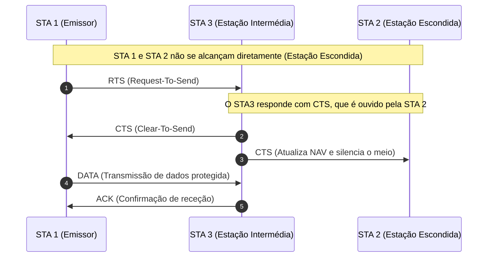
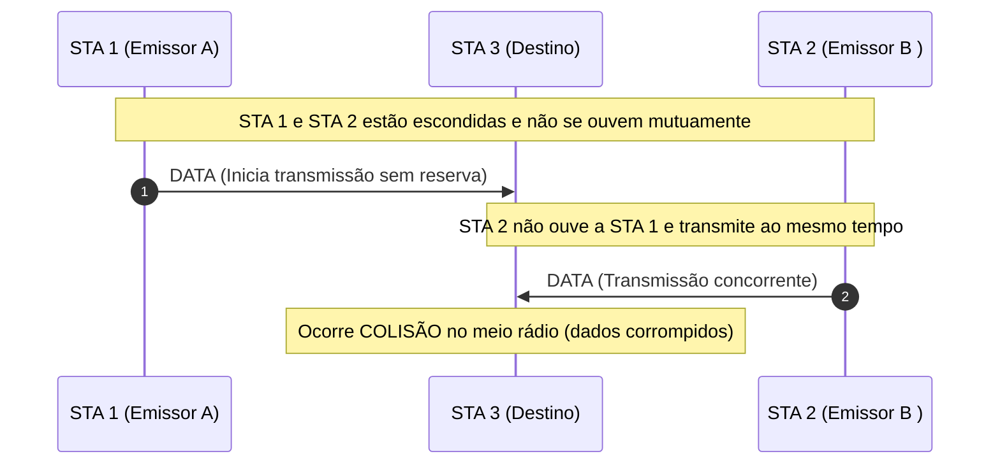

---
title:
date: 13/10/26
---

>[!]

# Salto 1 

(n4 -> n1) 

## ARP  Request 

| Enthernet |     | 
| --------- | --- | 
| DestEthAddr | FFFF....FFF|  
| SrcEthAddr | 00: ... : a1| 
| Type Filed | 0x806 | 
| **ARP** | |
| Req/Reply | 1|
| TargetEhtAddr | 0000...0000 |
| TargetIPAddr | 10.0.0.1/24 |
| ScrEthAddr | 00: ...: a1|
| ScrIPAddr | 10.0.0.20/24|

## ARP Reply 

| Enthernet |     | 
| --------- | --- | 
| DestEthAddr | 00: ... : a1 | 
| SrcEthAddr |  00:...:d4 | 
| Type Filed | 0x806 | 
| **ARP** | |
| Req/Reply | 2 |
| TargetEhtAddr | 00: ... : a1 |
| TargetIPAddr |  10.0.0.20/24 |
| ScrEthAddr | 00:...:d4  |
| ScrIPAddr | 10.0.0.1/24 |

# Salto 2 
(n1->n2)
## ARP Request 

| Enthernet |     | 
| --------- | --- | 
| DestEthAddr | FFFFFFF | 
| SrcEthAddr |  00:...:3e | 
| Type Filed | 0x806 | 
| **ARP** | |
| Req/Reply | 1 |
| TargetEhtAddr |  00000000 |
| TargetIPAddr | 10.0.1.2/24 |
| ScrEthAddr | 00:...:3e |
| ScrIPAddr | 10.0.0.1/24 |

## ARP Reply

| Enthernet |     | 
| --------- | --- | 
| DestEthAddr | 00:...:3e | 
| SrcEthAddr |  00:...:7c | 
| Type Filed | 0x806 | 
| **ARP** | |
| Req/Reply | 2 |
| TargetEhtAddr |  00:...:3e |
| TargetIPAddr | 10.0.0.1/24 |
| ScrEthAddr |  00:...:7c |
| ScrIPAddr | 10.0.1.2/24 |

# Salto 3
(n2->n8)
## ARP Request 

| Enthernet |     | 
| --------- | --- | 
| DestEthAddr | FFFFFFF | 
| SrcEthAddr |  00:...:e9 | 
| Type Filed | 0x806 | 
| **ARP** | |
| Req/Reply | 1 |
| TargetEhtAddr |  00000000 |
| TargetIPAddr | 10.0.2.21/24 |
| ScrEthAddr | 00:...:e9 |
| ScrIPAddr | 10.0.2.21/24  |

## ARP Reply

| Enthernet |     | 
| --------- | --- | 
| DestEthAddr | 00:...:e9 | 
| SrcEthAddr |  00:...:c2 | 
| Type Filed | 0x806 | 
| **ARP** | |
| Req/Reply | 2 |
| TargetEhtAddr |  00:...:e9 |
| TargetIPAddr | 10.0.2.1/24 |
| ScrEthAddr |  00:...:c2 |
| ScrIPAddr | 10.0.2.21/24 |

## Apontamento sobre wi-fi

ISto vai ficar aqui, porque não tenho onde o colocar, mas quando for fazer o meu resumo já o tenho guardado em algum lugar: 

Diferença entre Souce/destination e Transmitter/Receiver

- **Endereços Lógicos (Origem e Destino Finais):**
    
    - **Source Address (SA):** O endereço MAC do dispositivo original que gerou a trama.
        
    - **Destination Address (DA):** O endereço MAC do dispositivo final que vai processar a trama.
        
- **Endereços de Salto Físico / Rádio (Transmissor e Recetor Imediato):**
    
    - **Transmitter Address (TA):** O endereço MAC do equipamento de rádio que enviou a trama no salto atual (pode ser um AP intermediário ou um repetidor).
        
    - **Receiver Address (RA):** O endereço MAC do equipamento de rádio que se destina a receber a trama imediatamente a seguir.

