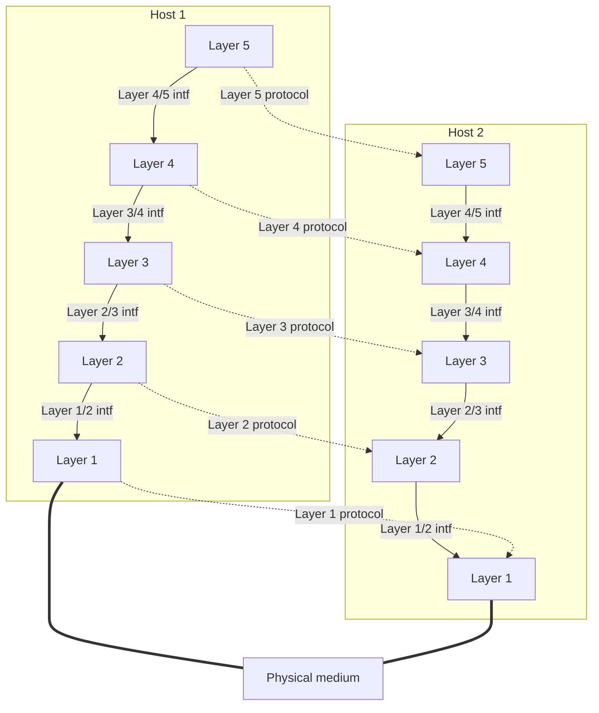
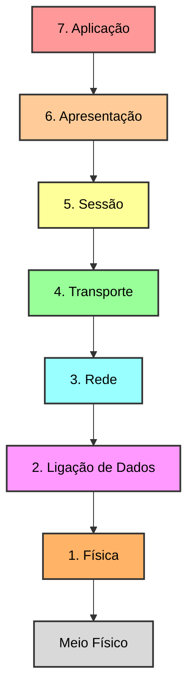
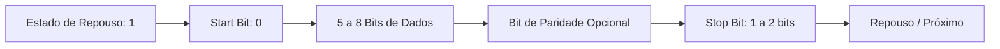
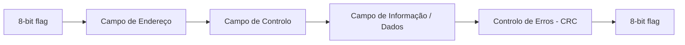

> [!warning] IN PROGRESS

# Fontes

> [!tldr]- Slides da aula 
> ![[LCC-SCR-1_unlocked.pdf]]

* [Redes de computadores para leigos que nem eu](https://youtu.be/9cF7jk4fiak?si=9CcdmyrnNaSXN-sm)
* [Cursos Fudamentos de Redes de Computadores e Internet](https://youtube.com/playlist?list=PLAp37wMSBouDdpuuYhZfEK9oH0qk0IANb&si=BEts14KuzEZQ7Eog)
* [O guia básico da TOPOLOGIA DE REDE!](https://youtu.be/yiFNfhRtxvs?si=F4ujtffmmiYhRkw7)

### Para estudos mais aprofundados
> [!attention] quando for estudar mesmo a matéria vale a pena dá uma olhada nos livros! 
* [Computer Networking: A Top-Down Approach](https://ebooks.karbust.me/Technology/Computer%20Networking%20A%20Top-Down%20Approach,%208th%20Edition%20by%20James%20F.%20Kurose,%20Keith%20W.%20Ross-Pearson-9780136681557.pdf)
Citado no slide 

* [Computer Networks — Andrew S. Tanenbaum e David J. Wetherall](https://networking.harshkapadia.me/files/books/computer-networks-tanenbaum-5th-edition.pdf)

* [**_Data and Computer Communications_ (DCC)** - **William Stallings**](https://fall14cs.wordpress.com/wp-content/uploads/2016/04/data_and_computer_communication_8th_edition_by_william_stalling.pdf) 
	No slide a professora tira ilustrações sempre desse livro 

# Redes de Computadores

## O que é uma _Rede de Computadores/Computer Networks_?

Conciste em um conjunto de sistemas terminais( como computadores, servidores, dispositivos móveis...) e outros dispositivos de hardware interligados entre si por meio de transmissão (com ou sem fios) om o objetivo de trocar dados entre si. 

A conexão de dois ou mais networks é chamado de **internetwork**. 

## As redes de computadores 
As redes de computadores podem ser designidas/organizadas de acordo com a área geográfica que sua cobertura abrange. 
1. BAN (Body Area Networks)
	até uma dezena de metros - exemplo: smartwatch a comunicar com auscultadores.
2. PAN (Personal Area Networks)
	até poucas dezenas de metros - exemplo: ligação de Bluetooth
3. LAN (Local Areas Networks)
	até poucas centenas de metros - exemplo: a rede usada nas casas. 
	> [!note] WiFi vs Ethernet
	> WiFi é como é popularmente conhecido o padrão IEEE 802.11 para wireless LANs. 
	> Enthernet é o nome do padrão IEEE 802.3 para wired LAN. 
4. MAN (Metropolitan Area Networks)
	cobertura de uma área metropolitana , até pouca dezenas de kilómetros. Conecta vários LAN. - exemplo: A rede de fibra que liga os edifícios públicos de uma cidade inteira.
5. WAN (Wide Area Networks)
	área alargada, acima das dezenas de kilómetros. - exemplo: A **Internet**. 

## Redes alargadas Vs Redes locais
As redes **WAN**, são redes alargadas, pois contam com linhas ponto-a-ponto, nós de acesso à rede, comutadores de tráfego e lida com transmissão a longs distâncias. 

Enquanto as redes **LAN**, são redes locais. Baseada em linhas e acessos multiponto, ponto-a-ponto a switch/ rede sem fios , acesso direto a rede e pequenas distâncias. 

# Redes Locais de Computadores (LAN)

## Características das LAN
* Permitem a interligação de um elevado número de sistemas terminais em áreas limitadas. 
* Em geral constituem redes privadas 
* Tecnologias normalizada e de baixo custo

## Elementos (Networking Hardware)
### Interfaces de Rede
* Network Interface Cards (NIC) - Placa de Rede
componente de hardware (placa física ou circuito integrado) instalado em cada estação que permite converter os dados digitais do computador em sinais elétricos, ópticos ou de rádio para serem transmitidos pelo meio.
### Equipamentos de Interligação
* Repetidores (Repeater)
	Equipamento da Camada 1 (Física) que regenera e amplifica o sinal elétrico/óptico enfraquecido pela distância, permitindo estender o alcance do cabo.
* Hub (Concentrador)
	Funciona como um repetidor de múltiplas portas. Recebe os dados de uma porta e **replica-os para todas as outras portas** (_broadcast_), o que causa colisões e torna a rede menos eficiente.
* Bridge (Ponte) e Switch (Comutador):
	Equipamentos da Camada 2 (Ligação de Dados). O **Switch** é uma evolução direta e moderna da _Bridge_. Em vez de enviar dados para toda a gente como o Hub, o Switch lê os endereços físicos (**MAC addresses**) e envia a informação **apenas para a porta do destinatário correto**.
* Router (Roteador):
	Equipamento da Camada 3 (Rede) que interliga redes **diferentes** (por exemplo, liga a rede local da tua casa ou universidade à Internet), encaminhando o tráfego com base nos **endereços IP**.

### Meios de Transmissão 
Podem ser por **cabagem ou wireless**
* cabo coaxial, UTP, fibra óptica... ( melhor explicado mais a frente)

## Topologias LAN 

### O que é a topologia?
É a maneira como os dispositivos estão interligados. O que influencia, na segurança e na estabilidade da rede. 

## Topologia Estrela 
Todas as estações ligam-se individualmente a um ponto central (como um **HUB Repetidor** ou um **Switch**) através de cabos UTP e portas RJ45. 
Sendo o nó central o responsável por determinar a velocidade de transmissão e conversão de sinais transmitidos por protocolos diferentes. 

### Vantagens: 
- **Isolamento de falhas:** Se um cabo ou uma estação falhar, apenas essa estação fica desligada; o resto da rede continua a funcionar normalmente.
    
- **Fácil expansão e gestão:** Adicionar ou remover uma estação é simples e não interrompe a rede.

### Desvantagens 
- **Dependência do elemento central:** Se o nó/equipamento central (Hub ou Switch) avariar, toda a rede vai abaixo.
    
- **Maior consumo de cabo:** Exige um cabo dedicado desde cada estação até ao equipamento central.

## Topologoia Barramento 
Todas as estções partilham um meio e transmissão central (cabo coaxial e conectores BNC. A transmissão funciona por **difusão no meio** (o sinal viaja em ambas as direções até ser absorvido pelos terminadores).

### Vantagens:
- **Custo reduzido:** Requer muito menos cablagem do que outras topologias.
    
- **Simplicidade de instalação:** Fácil de implementar em redes pequenas.
### Desvantagens 
- **Ponto único de falha:** Se o cabo central for danificado ou um terminador desligado, toda a rede fica indisponível.
    
- **Colisões e desempenho:** Como o meio é partilhado, apenas um computador pode transmitir de cada vez, o que degrada o desempenho à medida que mais estações são adicionadas.

## Topologia em Anel 
As estações estão interligadas em cadeia num circuito fechado por concentradores/estações. A **transmissão é unidirecional no meio** (o sinal circula de nó em nó num único sentido até atingir o destino).

### Vantagens 
- **Sem colisões:** Como a circulação é ordenada e unidirecional (frequentemente gerida por passagem de _token_), não ocorrem colisões de dados.
    
- **Comportamento previsível:** Mantém um desempenho regular mesmo sob tráfego elevado.

### Desvantagens 
- **Suscetível a falhas:** Em anéis simples, a quebra de uma ligação ou a avaria de uma estação pode interromper toda a comunicação no anel.
    
- **Reconfiguração difícil:** Adicionar ou mover estações requer cortar a ligação do anel temporariamente.

## Topologia em Árvore 
Estrutura hierárquica formada pela interligação de várias redes em estrela. Utiliza um equipamento principal (como um **HUB/Switch** superior) ligado a outros equipamentos secundários através de uma ligação do tipo **_Up-link_**.

### Vantagens 
- **Elevada escalabilidade:** Permite estruturar grandes redes por departamentos, edifícios ou setores.
- **Gestão e isolamento por segmentos:** Facilita a deteção e o isolamento de problemas num determinado ramo da árvore sem afetar o resto da organização.

### Desvantagens 

- **Dependência dos nós raiz/superior:** Se o switch central ou a ligação de _Up-link_ principal falhar, o segmento dependente perde o acesso ao resto da rede.
    
- **Configuração e custo mais elevados:** Requer mais equipamentos de comutação (_capacity de análise de endereços e switching_) e planeamento de cablagem.

# Modelos de referência 

## Network Architecture
Antes de introduzir os modelos proprianmente ditos, é preciso entender o que seria um modelo. 
Com fins de reduzir a complexidade de design, muitas redes de computadores são organizadas como uma _stack_ de _layers_/camadas. Onde o propósito de cada camada é oferecer um determinado **serviço** para as camadas acima, não sendo necessário que cada camada saiba como os serviços a elas prestados foram implementados. 
Quando uma camada $n$ em uma máquina se comunica com a camada $n$ em outra máquina, as regras e convenções para esta transmissão é conhecida como o **protocolo** da camada ${}n{}$. 

Na realidade, nenhum dado é diretamente transferido da layer ${}n{}$ da maquina para a layer ${}n{}$ da outra máquina. Cada camada passa para a camada mais embaixo até a _physical medium_, por onde a comunicação realmente acontece. 

+ **Interfaces**: A interface define quais as operações primitivas e serviços que a camada inferior disponibiliza à camada imediatamente superior. 

Apesar dos protocolos associados ao modelo OSI já não serem utilizados, o modelo em si é bastante geral e bem estruturado. Enquanto o modelo TCP/IP tem as propriedades opostas, o modelo não é usado porém os protocolos são amplamantes utilizados. 

## Open System Interconnection (OSI)

O modelo OSi tem 7 camadas. O modelo OSI não é uma arquiteturra de rede (_network architrcture_) porque ele não especifica os **serviços** e **protocolos** exatos para cada camada. 

> [!warning] Confirmar se a professora vai usar o modelo com 7 camadas (OSI) ou com 5 camadas como no [[#Fontes| livro do Tanebaum]] ! 

## TCP/IP Reference Models 
A comparação entre os modelos OSI e TCP/IP evidencia que, embora ambos partilhem uma arquitetura baseada em **camadas modulares** e ofereçam serviços de transporte e aplicação semelhantes, diferem profundamente na sua génese e conceção: o modelo OSI foi desenvolvido de forma teórica e rigorosa antes dos protocolos e possui sete camadas com uma separação estrita entre serviços, interfaces e protocolos, enquanto o modelo TCP/IP surgiu **empiricamente** a partir de protocolos já existentes, apresentando quatro camadas e uma flexibilidade superior ao suportar múltiplos modos de comunicação na camada de transporte. 

# Nível Físico 

## Funções do nível físico:

A Camada Física é a camada mais baixa da arquitetura de redes. O seu objetivo é **transmitir bits individuais (0s e 1s) através de um meio de transmissão físico** (seja um cabo de cobre, fibra óptica ou ondas de rádio no ar).
Também responsável pela codificação de linha, modulação, multiplexagem física, acesso ao meio, controlo de erros. 
Definição e normalização das características das interfaces físicas:
- mecânicas (conectores, nº de pinos e funções)
- elétricas (níveis elétricos)
- funcionais (controlo, dados, temporização)
- procedimentos (sequência de acções entre circuitos)

## Transmissão de dados 
### Quanto a topologia

-> Ponto-a-ponto (point-to-point): Existe uma linha de comunicação dedicada a dois dispossitivos.
	(Usado na topologia Estrela)
-> Multiponto: Todos os dispositivos partilham o mesmo meio físico/cabo central.
	(Usado na topologia Barramento)

### Quanto ao nº de destinatários
Centrado da lógica de **endereçamento** dos pacotes de dados. 
-> Unicast: trasmissão com um emissor e um recetor. Existe um campo no pacote de dados que especifíca o endereço do destinatário. E esse campo é verificado por todas as máquinas que recebem o pacote, se o endereço é o seu ela processa os dados, se não apenas o ignora. 

-> Broadcast: 	O emissor usa um código especial de endereço reservado no cabeçalho do pacote que faz com que nenhum dispositivo que receba o pacote o ignore, ou seja, a mensagem é transmitida para todos os dispositivos na rede. 

-> Multicasting; A mensagem é enviada por 1 emissor apenas para um subconjunto específico de nós. 
### Quanto direção do fluxo 
#### Simplex (Unidirecional)
A transmissão ocorre em uma **única direção**, um dispositivo apenas envia dados e o outro apenas recebe. 

Exemplo: Teclado a enviar dados ao computador. 

#### Half-duplex (Bidirecional, Alternado)
Os dados podem viajar nos dois sentidos, mas **apenas um dispositivo transmite de cada vez**. 

Exemplo: Walkie-talkies

#### Full-duplex (Bidirecional, Simultâneo)
Os dados viajam nos **dois sentidos ao mesmo tempo**. Ambos os dispositivos podem enviar e receber dados simultaneamente sem interferência.

Exemplo: Uma chamada telefónica. 

 > [!info] **Por que é importante para FANETs (Drones)?**
> - No ar, **todas as comunicações sem fios são inerentemente Multiponto (MP)**, porque as ondas de rádio se propagam pelo espaço e podem ser ouvidas por vários drones em redor. 
> - Gerir como os drones partilham esse meio em modo **half-duplex** sem causar colisões e atrasos é um dos maiores desafios do projeto da camada MAC em FANETs!

## Meios de trasmissão 
São as formas físicas utilizadas para interligar os computadores e dispositivos a rede. 
Eles afetam diretamente a qualidade da comunicação. 
- **Efeitos Indesejáveis no Sinal:**
    
    - **Atenuação:** A perda de força do sinal à medida que ele percorre a distância.
        
    - **Distorção (Ruído e _Cross-talk_):** Interferências no canal que corrompem os dados, gerando erros.
        
- **Factores de Influência:** A gravidade da atenuação e distorção depende da **distância** entre emissor e recetor, da **taxa de transmissão** (bps, Kbps, Mbps, Gbps) e do **tipo de meio**.

Podem ser divididos em dois grupos:

### Meios guiados
São os cabos físicos que podem utilizar como meio físico : cobre, vidro, plástico ou sílica. 

#### Par entraçado 
Composto por 4 pares de fios entrelaçados entre si e envoltos por uma camada de borracha. 

##### Unshielded Twisted Pair (UTP)
Não possui qualquer tipo de blindagem ou proteção contra interferência. A única forma para garantir a passagem dos dados é o fenômeno físico chamado: Efeito Cancelamento. Esse efeito trabalha em cima da anulação dos campos eletromagnéticos dos fios quando um sinal é enviado através deles.  

##### Shielded Twisted Pair (STP)
São os cabos de par trançado que possui uma blindagem metálica mais um fio terra. 

#### Cabo Coaxial 
Composto por um condutor central de cobre envolvido por um isolante, uma malha metálica externa e uma capa protetora:

- **Aplicações Históricas e Atuais:** Muito utilizado em redes locais antigas (topologia em barramento) e na transmissão de televisão por cabo.
    
- **Vantagem em relação ao par trançado:** A malha externa oferece melhor blindagem contra interferências eletromagnéticas.

#### Fibra Óptica 
Transmite a informação através de feixes de **luz** (em vez de impulsos elétricos) através de um núcleo de vidro ou plástico:

- **Vantagens Principais:**
    
    - **Elevada largura de banda:** Permite velocidades extremamente altas.
        
    - **Baixa atenuação:** Permite cobrir grandes distâncias sem perder força de sinal.
        
    - **Imunidade Eletromagnética:** Não sofre nem gera interferências elétricas.
        
    - **Tamanho e peso reduzidos:** Muito mais leve e fina que os cabos de cobre.
        
- **Tipos de Fibra:**
    
    - **Monomodo (_Single-mode_):** A luz viaja num único feixe reto. Usada para **longas distâncias**.
        
    - **Multimodo:** A luz reflete-se em múltiplos ângulos dentro do núcleo. Usada para **curtas distâncias**.

### Meios não guiados 
São os meios atmosféricos, são eles: wi-fi, bluetooth, infravermelho, NFC...

## Comunicação de Dados
A transmissão dos dados pode ser em paralelo (cada bit é transmitido paralelamente em simultâneo, cada um por um fio) ou em série (os bits são enviados consecutivamente pelo mesmo canal).

Parâmetros fundamentais que temos de medir e conhecer numa transmissão física: 
-> **Ritimo (Bitrate)**: A velocidade que os bits são ejetados no canal (medido em bps- bits por segundo- Kbps, Mbps...);

> |     | Armazenamento | Transmissão |
> | -- | --------- | --------- |
> | K | ${}2^10{}$ | ${}10^3{}$| 
> | M | ${}2^20{}$ | ${}10^6{}$|
> | G | ${}2^30{}$ | ${}10^9{}$ | 

-> **Potência do Sinal**: Energia do sinal elétrico, ótico ou de rádio wue viaja pelo meio (medido em miliwatts ${}mW{}$ ou decibéis-miliwatts ${}dBm{}$);
-> **Código de Linha**: Forma física exata que o sinal assume para representar os 0s e os 1s (ex: como é que a voltagem varia no cabo para que o recetor saiba distinguir um zero de um um);
-> **Bit Error Rate (BER)** - $P_{e}$: Probabilidade estatística de um bit corromper-se e chegar trocado ao destino devido ao ruído do canal; 

### Técnicas de transmissão em série 
#### Transmissão Assícrona
> [!note] A professora não tem muito interesse em transmissão assícrona

* Estratégia:
	Enviar dados em pequenas unidades(caracter);
	Envia código de caracter (5 a 8 bits) de cada vez;
	Os caracteres occorem assincronamente;

| Vantagens | Desvantagens | 
| --- | --- |
| Sicronização no ínicio e dentro de cada caracter | **overhead** elevado (em geral >20%) |
| Esquema simples e económico | erros resultantes de assimetrias | 

#### Transmissão Sícrona
Utilizada para transmitir unidades de dados maiores;
Sicronização transmissor (Tx) com receptor (Rx):
	Não são usados start/stop bits;
	ou existe um canal separado de sicronização 
		[chamada sicronização fora da banda]
	ou a sicronização faz-se no canal dos dados 
		[chamada sicronização dentro da banda]
	
#### Trama (Frame)
A trama é a designação dada à unidade de dados ao nível físico.
Composta pelo campo de controlo(endereços destino/origem, comprimento da trama, número de sequência, tipo dos dados...) mais o campo de dados.

##### Detecção de início e/ou fim da trama
Caracteres especiais ou padrão de bits de alinhamento (flag). 
Os blocos começam com um _preâmbulo_ e um _pos-âmbulo_. 

## Detecção de erros
A cada trama, o Tx adiciona um número de bits que será usado pelo Rx para detecção de erros.  

### Teste de Paridade 
Um bit de paridade é adicionado para cada caracter de 7-bit. O valor desse bit é escolhido para que o caracter tenha um número par de 1s (even parity) ou um número ímpar de 1s (odd parity). 

Exemplo da aula: 
Considerando uma paridade par, se foi enviado:
$$
\overbrace{01011}^{\text{Data field}}\underbrace{1}_{\text{bit de paridade}} 
$$

E por algum erro na transmissão é recebido 
$$
\overbrace{0\underline{0}011}^{\text{Data field}}\underbrace{1}_{\text{bit de paridade}}
$$
É detectado o erro pois existe apenas 3 bits com valor 1, e paridade diz que deveria haver um número ímpar de 1s. 
### Cyclic Redundacy Check (CRC)
Dado um bloco k-bits, o transmissor gera uma sequenência com $(n-k)$-bit conhecida como _frame check sequence(FCS)_, de modo que o frame resultante, com ${}n{}$ bits, é divisível por algum número predeterminado. 
O recetor então, divide o frame recebido pelo numero e, se o resto é zero, assume que houve algum erro.

O livro  [**_Data and Computer Communications_ (DCC)** - **William Stallings**](https://fall14cs.wordpress.com/wp-content/uploads/2016/04/data_and_computer_communication_8th_edition_by_william_stalling.pdf) mostra o processo em 3 formas equivalentes. 

#### Exercício ([[LCC-SCR-1_unlocked.pdf|slide]])
Seja ${}g(x)= 1 + x + x^3{}$ um polinómio gerador de um código sistemático (7,4). 

Já podemos interpretar o **polinómio gerador** ${}g(x)= 1 + x + x^3{}$ em forma binária. 
Em formato binário, os coeficientes das potências de x são:
$$
x^0 (1) \rightarrow 1
x^1 (1x) \rightarrow 1
x^2 \rightarrow 0
x^3 (1x^3) \rightarrow 1
$$

Portanto, g = (1011). 

E o **código sistemático** (7,4):
* ${}n{}$ = 7 (tamanho total da palavra de código)
* ${}k{}$ = (tamanho dos dados originais)

O número de bist de redundância (CRC) é ${} n-k = 7 - 4 = 3{}$ bits. 
Significa que o grau máximo do resto será 2 (3 bits: $r_{2}, r_{1}, r_{0}$)

##### Calcular as Palavras de Código para os Dados

Para  $D_{1}(x) = (1010)$ :

1. Converter os dados em polinómio 
	${}D_{1} = 1 \times x^0 + 0 \times x^1 + 1 \times x^2 = 1 + x^2{}$
2. Multiplicar por $x^{n-k}$ (ou seja, ${}x^3{}$):
	* $x^3 \times D_{1}(x) = x^3 \times (1+x^2) = x^3 + x^5$
3. Efetuar a divisão polinomial por ${}G(x)= x^3 + x + 1{}$
$$
\begin{array}{r@{\quad}l}
   x^5 + x^3   & \Big\lfloor \underline{x^3 + x + 1} \\
  -\left(x^5 + x^3 + x^2\right)  &  \quad x^2\\
  \hline
  0 \quad 0 \quad 1 
\end{array}
$$

$$
\text{Resto} = x^2 = 001
$$

$$
\begin{array}{c}
  \underbrace{0 \quad 0 \quad 1}_{x^0 \quad x^1 \quad x^2} \quad \Big| \quad 1 \quad 0 \quad 1 \quad 0
\end{array}
$$

Para $D_{2} = (1100)$
1. Converter os dados pem polinómio
	$D_{2} = 1 + x$ 
2. Multiplicar por $x^3$:
	$x^3 \times D_{2}(x) = x^3 \times (1+x) = x^3 + x^4$
3. Divisão 
$$
\begin{array}{r@{\quad}l}
  x^4 + x^3 & \Big\lfloor \underline{x^3 + x + 1} \\ 
  -\left(x^4 + x^2 + x\right) & \quad x \\
  \hline 
  x^3 + x^2 + x & \quad 1  \\
  -\left(x^3 + x + 1\right) &  \\
  \hline 
    \left(x^2 + 1\right) &  \text{ <-- Resto}
\end{array}
$$

##### Se o receptor receber a palavra de código C = (0110101) será esta válida no contexto do código referido ? Justifique.

> [!note] Para saber se uma palavra de código recebida é válida, o recetor tem de fazer a divisão exata de toda a palavra recebida por g=(1011). 
> Se o resto for diferente de (000), há um erro e a palavra é inválida. 

1. Converter C para polinómio
	${}C = 0 \times x^0 + 1 \times x^1 + 1 \times x^2 + 0 \times x^3 + 1 \times x^4 + 0 \times x^5 + 1 \times x^6 = x^6 + x^4 + x^2 + x{}$
2. Dividir 

$$
\begin{array}{r@{\quad}l}
  x^6 + x^4 + x^2 + x & \Big\lfloor \underline{x^3 + x + 1}  \\
  -\left(x^6 + x^4 + x^2\right) & \quad x^3  \\
  \hline 
  x^3 + x^2 + x & \quad 1 \\
  -\left(x^3 + x + 1\right) &  \\
  \hline 
  x^2 + x & \text{--Resto}\\
\end{array}
$$

Como o resto é diferente de 0, a mensaagem C é inválida. 

##### E se a palavra recebida for C = (0011010) ?
1. Converter C para polinómio 
	$C = 0 \times x^0 +  0 \times x^1 + 1 \times x^2 + 1 \times x^3 + 0 \times x^4 + 1 \times x^5 + 0 \times x^6 = x^5 + x^3 + x^2$
2. Dividir 
$$
\begin{array}{r@{\quad}l} \\
x^5 + x^3 + x^2 & \Big\lfloor \underline{x^3 + x + 1} \\
-\left(x^5 + x^3 + x^2\right) & x^2 \\
\hline  
0 & \text{-- Resto}
\end{array}
$$

Como o resto é 0, a palavra é válida. 

## Correção de erros

### Foward Error Correction (FEC)
é o receptor que corrige o erro
• probabilidades de erro aceitáveis exigem que o código seja gerado por polinómio com grau da mesma ordem de grandeza do dos dados.
• técnica pouco usada em comunicação de dados
• apenas usada em situações onde é impraticável a retransmissão
• em geral, é preferível retransmitir

### Automatic Repeat Request (ARQ)
• o receptor não tenta corrigir os erros
• o código de controlo de erros é usado no receptor apenas como detector erros
• detectados erros, o receptor pede a retransmissão da unidade de dados
• probabilidades de erro aceitáveis podem ser obtidas com polinómios de menor grau
• técnica mais usada em comunicação de dados

