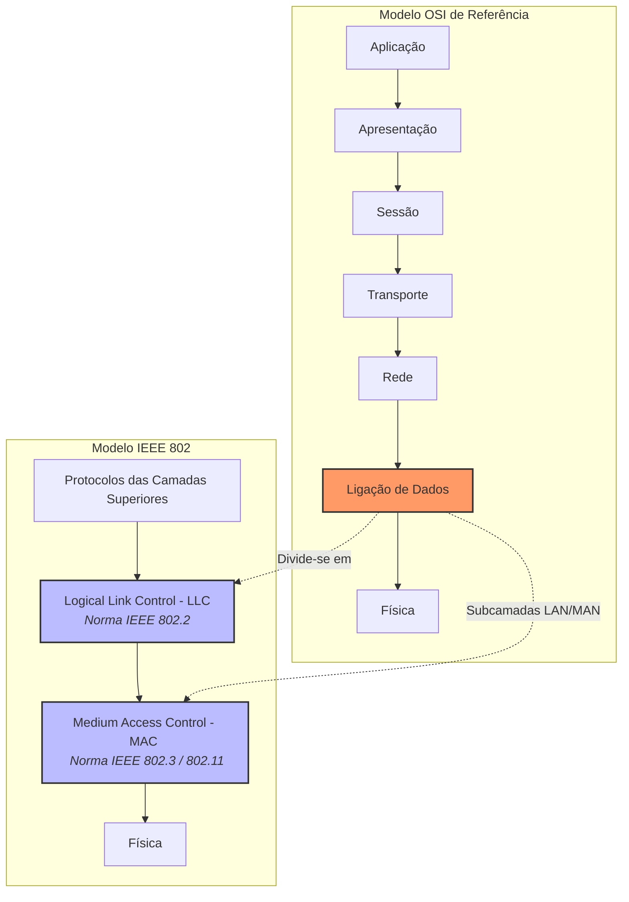

# Fontes

## Slides 
> [!tldr]- Slides da aula 
> ![[LCC-SCR-2_unlocked.pdf]]

* [Playlist Computer Networks - Neso Academy](https://youtube.com/playlist?list=PLBlnK6fEyqRgMCUAG0XRw78UA8qnv6jEx&si=JOIB-pctFDvWMChx)

# Controlo da ligação de dados

A troca de dados entre entidades que pretendem comunicar deve ser regulada a fim de se criar um _contexto_ comum e um _sincronismo_ entre elas. 

São necessárias **regras** definindo como se faz a transferência dos dados, os chamados **Protocolo de comunicação**.

> Os protocolos de ligação lógica ou ligação de dados constituem o primeiro nível de troca ordenada, controlada e fiável de dados entre sistemas interligados por meio de uma ligação física. 

## Nível físico Vs Nível de ligação lógica

| Nível Físico | Nível de ligação lógica | 
| ------------ | ----------------------- | 
| * envio de um sinal sobre um meio de transmissão | * estrutura das tramas | 
| * sincronismo (nível do bit) | * configuração e acesso à linha |
| * ==🔵codificação de linha== | * controlo de fluxo | 
| * ==🔵modulação do sinal== | * controlo de erros | 
| * ==🔵multiplexagem física== | * gestão da ligação (controlo de troca de dados) |
| * interface com o meio | 

> [!note] O que está em ==🔵lore ipsum== é porque tenho que pesquisar a definição. 

## Funções do nível 2 
- Definição da trama: 
	formato da unidade de dados (Protocol data unit - PDU);
- Configuração da linha :
	considera a topologia , define a disciplina de acesso à linha e a sua duplexidade;
- Endereçamento:
	identifica os interfaces das estações que podem enviar e receber tramas;
- Controlo de fluxo:
	regula a cadência de tramas enviadas;
- Controlo de erros:
	detecta erros de transmissão e executa procedimentos de recuperação 
- Gestão da ligação:
	define como se faz o estabelecimento, a manutenção e a terminação da associação lógica. 

### Definição da trama 
Exemplo de um formato e semântica 

Cada protocolo define um formato de PDU, bem como os valores, o significado e o comprimento dos seus campos. 

